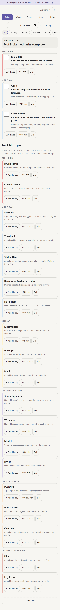

# Color Sprint

A calm, color-coded surface for habits, tasks, goals, and focus sessions in **Obsidian on iPhone, iPad, and desktop**. Your tracker is an ordinary Markdown note: edit it in Obsidian or tap through the interface. Both use the same data.



## Install with BRAT

1. Install and enable [BRAT](https://github.com/TfTHacker/obsidian42-brat) from Obsidian's community plugins on your iPhone.
2. In BRAT settings, choose **Add beta plugin** and enter **`https://github.com/jogurtfm/color-sprint`**.
3. Enable **Color Sprint** in community plugins.
4. Run **Color Sprint: Create starter Markdown note**, then **Color Sprint: Open tracker** from the command palette. You can add Open tracker to Obsidian's mobile toolbar.
5. Choose **Pages** to plan your first tasks. Edit a task's **Page** field to create your own pages, such as Morning, Workouts, Room, or Creative.

The default note is `Sync/Color Sprint.md`. To use an existing note in this format, run **Color Sprint: Choose tracker Markdown note**. The plugin never replaces an existing note when creating a starter.

For a manual installation, download `manifest.json`, `main.js`, and `styles.css` from [Releases](https://github.com/jogurtfm/color-sprint/releases) and put them in `<vault>/.obsidian/plugins/color-sprint/`. Enable the plugin in Obsidian. No build is required.

## What you get

- **Today:** the selected day's explicitly planned tasks, color-coded completion progress, plus an **Available to plan** section for the remaining tasks. The planned count stays honest; a task is not made due merely because it is visible.
- **Fast phone layout:** on narrow screens, branding and secondary status collapse, page filters become a single swipe row, and the first task card comes before the fold. Tap targets remain at least 40–44 px.
- **Week:** a task-per-row, day-per-column grid. A blank `+` means unscheduled. Tap to plan; tap a planned cell to check it.
- **Pages:** your Markdown page labels become navigation filters. Morning, Workouts, Kitchen, Room, Learning, Creative, Admin, and Portfolio are starter interpretations you can change.
- **Goals:** milestones with due dates and evidence. The interface asks for evidence before marking a goal done.
- **History:** focus sessions with elapsed time and the actual result you record. Training details can go in the result or Day details.
- **Focus timer / stopwatch:** start, pause, resume, and save. The active timer and saved sessions live in Markdown. Elapsed time recovers when you return after sleep or app restart.
- **Direct Markdown editing:** checkboxes, task definitions, colors, pages, schedules, recurring weekdays, goals, and timer records remain readable text. File changes refresh the interface.

The six colors match the source palette exactly: pink `#ea9999`, blue `#cfe2f3`, yellow `#fff2cc`, purple `#d9d2e9`, orange `#fce5cd`, and salmon `#e6b8af`. Pages do not merge or reinterpret these color groups.

The starter retains 22 task labels with every task initially **unscheduled**. Set Repeat to `daily` or `mon,wed,fri` to opt into a recurring habit during the Sprint dates. A focus duration is a suggestion for attention, not an exercise prescription. Exercise components never count themselves as additional workouts.

## Markdown is the source of truth

See [FORMAT.md](FORMAT.md) for the complete schema and [examples/Color Sprint.md](examples/Color%20Sprint.md) for a generic example. The format uses standard headings, tables, and `- [ ]` checkboxes. Personal vault contents and daily notes are not published in this repository.

The existing planning document stays useful context. A prose plan is not automatically imported: explicit task IDs, dates, and checkboxes in the tracker determine what appears. This avoids guessing completion, frequency, or workout programming from ordinary prose. A planning assistant can edit the tracker using the same documented format.

## Daily notes and embedded dashboards · new in 0.2.0

Run **Color Sprint: Open or create today’s daily dashboard**. The plugin creates a daily note with date metadata and a working dashboard embed, or opens the existing note without replacing its content. To create another day, use **Color Sprint: Create daily dashboard for a date**.

Linked daily notes can automatically open the full sprint interface for **their own date**. Use **Daily note ↗** in the interface to return to the daily Markdown without being redirected again. To stay with the inline dashboard, set `sprint-open: false` in that note. A global switch is available under **Settings → Color Sprint → Open linked daily notes as a sprint**.

To use your existing daily notes, add the properties and embed documented in [DAILY.md](DAILY.md). To scaffold new days with Obsidian's Daily Notes core plugin, choose [examples/Daily Template.md](examples/Daily%20Template.md) as its template. Properties use standard YAML and templates use Obsidian's built-in date tokens. No scheduler or extra template plugin is required; notes are generated when you create/open a day.

Embedded and full-screen dashboards share the same tracker note. They do not duplicate checkboxes into the daily note. The daily body stays available for notes and reflection; the tracker keeps dated progress and sessions. Embeds work in Reading view and rendered code blocks in Live Preview; Source mode shows the editable code block.

## Mobile behavior and limits

No Node.js, filesystem, Electron, or network APIs are used by the plugin. Obsidian's Vault API performs reads and atomic edits. No account, analytics, or external service is required.

iOS can suspend Obsidian. The timer uses persisted timestamps instead of counting background ticks, so elapsed time is reconstructed on return. **There is no background alarm or push notification.** The timer continues until you pause/save; reaching the focus target does not end it or mark work complete. Before changing devices, pause or save the timer. Vault sync conflicts across two simultaneously active devices still require your sync provider's conflict handling.

**Verification:** parser/write/timer tests, actual plugin lifecycle tests with an Obsidian API harness, and narrow-viewport browser interaction checks are provided. Browser checks are not real-device iPhone validation. A real iPhone installation remains the final device check.

## Development

```sh
npm ci
npm run typecheck
npm test
npm run build
npm run preview
```

Preview serves the same surface at `http://127.0.0.1:8776` with generic browser-local demo data. It is a developer preview, not a hosted replacement for Obsidian. Release files are checked into the repo and attached to versioned GitHub releases for BRAT.

License: [MIT](LICENSE).
